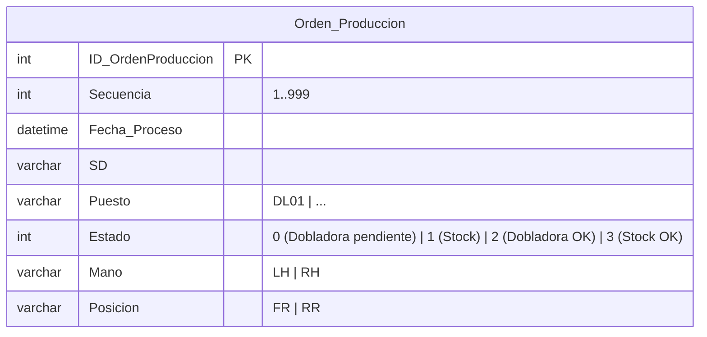
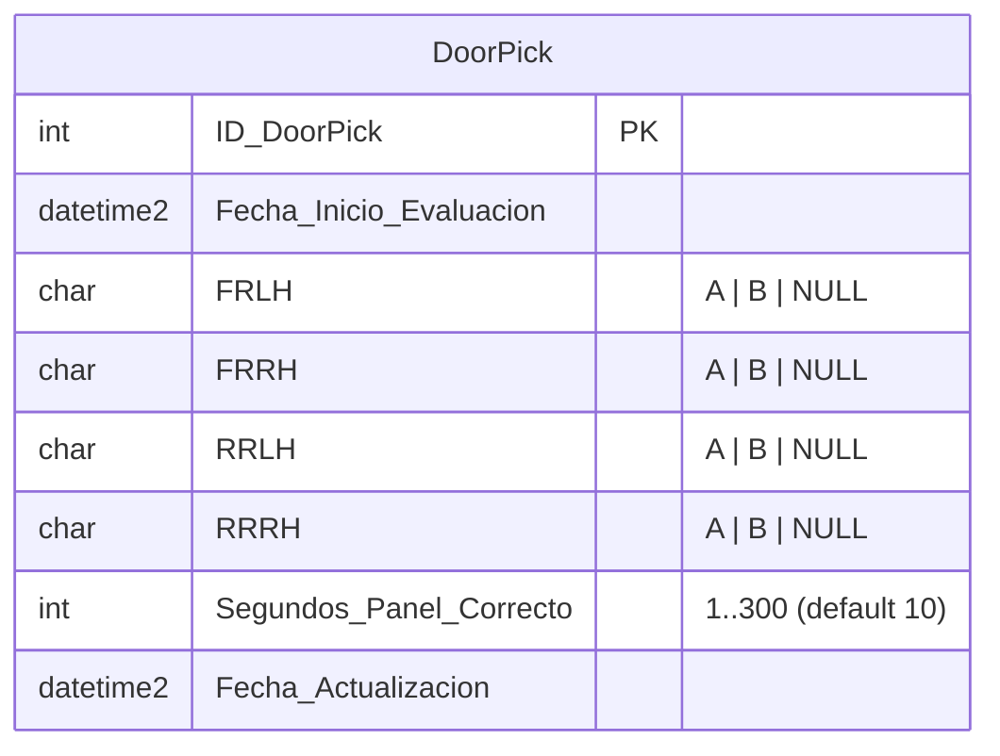

# DoorPick

Aplicación para una línea de producción de paneles de puerta, específicamente para el último puesto de la misma (revisión pre-calidad).

Actualmente, la línea de producción utiliza las siguientes convenciones: un número de secuencia para identificar el vehículo, y un código adicional para identificar el tipo de panel que se está trabajando. El número de secuencia es un número del 1 al 999, y el código del panel es FRLH (Front Left Hand), FRRH (Front Right Hand), RRLH (Rear Left Hand), RRRH (Rear Right Hand).

La línea de producción siempre utiliza números de secuencia consecutivos, y dentro de una misma secuencia, se trabajan primero los paneles delanteros (FRLH y FRRH) y luego los paneles traseros (RRLH y RRRH). El vehículo puede ser cabina simple o doble, por lo que no todas las secuencias tienen paneles traseros. Existen múltiples estilos de paneles, pero todos los paneles de una misma secuencia siempre utilizan el mismo estilo.

El trabajo se realiza en dos líneas paralelas (A y B) que trabajan simultáneamente, cada una con su propio operario. Sin embargo, ambas trabajan las mismas secuencias (es decir, entre las dos líneas se trabajan todos los paneles para un mismo vehículo): por ejemplo, mientras un operario trabaja un panel LH (Left Hand), el otro operario trabaja un panel RH (Right Hand).

En la aplicación debe ser posible configurar, para cada línea (A o B), qué paneles se desea trabajar. Esto brinda flexibilidad:

- Hoy la línea A produce FRLH y RRRH, mientras que la línea B produce FRRH y RRLH.
- Mañana cambia la forma de trabajar, y la línea A produce FRLH y RRLH, mientras que la línea B produce FRRH y RRRH.
- La semana que viene se rompe la línea B, y la línea A debe producir todos los paneles (FRLH, FRRH, RRLH y RRRH).

Si hubieran demoras en la producción, un superior puede decidir que se utilicen paneles del stock de seguridad, omitiendo secuencias en la línea de producción. Por ejemplo, supongamos que al comienzo del día se solicitó producción de las secuencias 1, 2, 3, 4 y 5, pero debido a un retraso, el superior decidió que los paneles correspondientes a las secuencias 3 y 4 se tomen del stock de seguridad. Los pasos a seguir por los operarios serían los siguientes:

1. Secuencia 1
    1. Tomar panel delantero de la etapa anterior de la línea de producción.
    2. Si el vehículo es doble cabina, tomar panel trasero de la etapa anterior de la línea de producción.
2. Secuencia 2
    1. Tomar panel delantero de la etapa anterior de la línea de producción.
    2. Si el vehículo es doble cabina, tomar panel trasero de la etapa anterior de la línea de producción.
3. Secuencia 3
    1. Tomar panel delantero del stock de seguridad.
    2. Si el vehículo es doble cabina, tomar panel trasero del stock de seguridad.
4. Secuencia 4
    1. Tomar panel delantero del stock de seguridad.
    2. Si el vehículo es doble cabina, tomar panel trasero del stock de seguridad.
5. Secuencia 5
    1. Tomar panel delantero de la etapa anterior de la línea de producción.
    2. Si el vehículo es doble cabina, tomar panel trasero de la etapa anterior de la línea de producción.

Como se puede ver, al final de la línea, los paneles deben siempre llegar respetando el orden de secuencia, y dentro de cada secuencia, respetando el orden de paneles (delanteros primero, traseros después).

La aplicación debe ser versátil, permitiendo omitir secuencias completas, o solo paneles específicos. Por ejemplo, si hay demoras en la línea, se pueden omitir secuencias completas para permitirle a la línea recuperar el ritmo; si faltan insumos para paneles delanteros, se pueden omitir solo los paneles delanteros de las secuencias deseadas; o si faltan insumos específicamente de paneles traseros izquierdos (RRLH), se pueden omitir solo esos paneles de las secuencias deseadas. La omisión de secuencias o paneles específicos la realiza un sistema externo, actualizando la base de datos que lee la aplicación.

---

La aplicación debe realizar dos tareas principales:

- Llevar un registro de qué panel se está trabajando actualmente. Esto permite que, si el operario se olvida de qué panel estaba trabajando, pueda consultarlo y continuar con su trabajo sin problemas. Lo mismo aplica si otro operario necesita retomar el trabajo durante la jornada. También permite saber cuál es el siguiente panel que se debe trabajar.
- Indicarle al operario de dónde tomar el siguiente panel a trabajar: desde la etapa anterior de la línea de producción, o desde el stock de seguridad. Esta indicación debe ser clara, rápida, precisa, intuitiva y fácil de entender. Es importante evitar confusiones para evitar errores y demoras.

Por lo tanto, la interfaz de la aplicación será sencilla, con pocos elementos visuales, visibles incluso a distancia, utilizando colores que permitan identificar rápidamente el estado de la producción y la ubicación de los paneles.

En el día a día, la única interacción manual que debería realizar el operario con el teclado y el mouse es abrir la aplicación. Debe haber un apartado de configuración, donde se puedan establecer los parámetros de funcionamiento, pero solo se utilizaría en situaciones excepcionales.

Para indicar que tomó un panel, el operario utiliza un escáner de códigos QR. Al escanear el código del panel, la aplicación registra automáticamente que ese panel fue tomado, y, si es el correcto, actualiza el estado de la producción.

La interfaz debe tener un selector A/B, para indicar en qué línea se encuentra el operario. Debe mostrar, para dicha línea, los paneles que se deben trabajar a continuación (número de secuencia y tipo de panel), indicando claramente si se deben tomar de la etapa anterior de la línea de producción (DOBLADORA) o del stock de seguridad (STOCK). Al escanear un panel, si es correcto debe marcarse en verde, y luego de una cantidad configurable de segundos, eliminar ese panel de la lista de elementos; si es incorrecto, debe marcarse en rojo y permanecer en la lista hasta que se escanee el panel correcto.

- Si se está esperando un panel de DOBLADORA, indicarlo y resaltarlo en verde claro.
- Si se está esperando un panel de STOCK, indicarlo y resaltarlo en amarillo.
- Si el panel escaneado es el correcto, indicarlo en verde.
- Si el panel escaneado es incorrecto, indicarlo en rojo.

---

La base de datos a utilizar es Microsoft SQL Server 2022, y la aplicación debe estar desarrollada con Next.js.

Los datos del resto de la línea de producción necesarios para el funcionamiento de la aplicación se encuentran en la tabla `dbo.Orden_Produccion`. Las columnas relevantes de la tabla son las siguientes:



Si el estado es 0, el panel viene de la etapa anterior de la línea de producción. Si el estado es 1, el panel debe ser tomado del stock de seguridad.

```sql
SELECT 
    [ID_OrdenProduccion],
    [Secuencia],
    [Fecha_Proceso],
    [SD],
    [Estado],
    [Mano],
    [Posicion]
FROM [dbo].[Orden_Produccion]
WHERE [Puesto] = 'DL01'
  AND [Fecha_Proceso] > @FECHA_INICIO_EVALUACION
  AND [Estado] IN (0, 1)
ORDER BY
    [Fecha_Proceso] ASC,
    [Posicion] ASC,
    [Mano] ASC,
    [ID_OrdenProduccion] ASC;
```

FECHA_INICIO_EVALUACION es la fecha a partir de la cual se quiere evaluar paneles, una variable que debe ser configurable en la configuración del sistema. Cualquier panel con fecha de proceso anterior a la misma representa producción realizada antes de la implementación del sistema.

La configuración de la aplicación se almacena en la tabla histórica `dbo.DoorPick`. Cada guardado inserta una nueva fila y la aplicación utiliza siempre la más reciente (`ORDER BY [Fecha_Actualizacion] DESC, [ID_DoorPick] DESC`).



El flujo de ejecución básico de la aplicación consiste en leer `dbo.Orden_Produccion` con la query especificada anteriormente para obtener todos los paneles pendientes de la línea seleccionada. A medida que el operario toma paneles y los escanea, modifica su columna de estado según corresponda:

- Si el panel fue tomado de la etapa anterior de la línea de producción, actualiza su estado a 2.
- Si el panel fue tomado del stock de seguridad, actualiza su estado a 3.

El QR que lee el operario contiene el texto `ID_OrdenProduccion|Secuencia|SD|Posicion|Mano`, por ejemplo `"15628|1|D3L|RR|RH"`. El escáner funciona por teclado (modo HID terminando en `Enter`) sin ningún campo de texto visible en pantalla. La aplicación extrae los 5 campos y exige coincidencia exacta contra el panel activo en `dbo.Orden_Produccion` (tanto para `DOBLADORA` como para `STOCK`) para determinar si el panel escaneado es correcto.

> [!caution]
> El teclado debe estar configurado en inglés para que el escáner funcione correctamente. Sino, el escáner puede enviar caracteres incorrectos que no son los del código QR, y la aplicación marcará el panel como incorrecto.

---

Los aspectos configurables de la aplicación deben ser los siguientes.

- Paneles a procesar (FRLH, FRRH, RRLH, RRRH) por línea A, y paneles a procesar por línea B, mutuamente exclusivos (un tipo de panel solo puede ser procesado por A, por B, o por ninguna, pero nunca por ambas).
- La fecha a partir de la cual se desea evaluar paneles, ignorando todos los paneles anteriores a la misma.
- La cantidad de segundos que debe permanecer un panel marcado como correcto antes de desaparecer de la lista y pasar al siguiente (por defecto 10).

## Ejecución local

Configurar la variable de entorno `DB_URL` en `.env` (ver `.env.example`).

Ejecutar el simulador de la línea de producción con `npm run sim` para insertar secuencias periódicamente y exponer QRs escaneables en `http://localhost:4000`.
